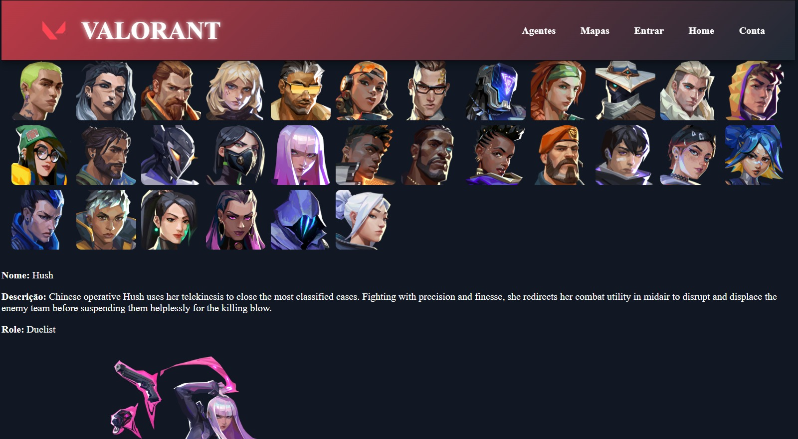

VALORANT WEB

Aplicação web desenvolvida para consultar informações do jogo VALORANT, como agentes, mapas e ranks. O projeto utiliza React e JavaScript no frontend, Node.js e Express no backend e MySQL para armazenamento de dados.

-Tecnologias utilizadas

Frontend
- React
- JavaScript
- CSS Modules

Backend
- Node.js
- Express

Banco de dados
- MySQL
- XAMPP

API externa
- [Valorant API](https://valorant-api.com/)

-O que você irá precisar

Antes de executar o projeto, será necessário instalar:

- Node.js
- MySQL(utilizando XAMPP, não esqueça de ligar o apache junto com o MySQL)
- Git(https://git-scm.com/)
- Um editor de código, como Visual Studio Code.

-Instalar as dependências

Na pasta do frontend:

bash
npm install

-Na pasta do backend:

bash
npm install

-Executar o projeto

Inicie o backend(tenha certeza que está na pasta backend)

bash
npm start

-Inicie o frontend:

bash
npm run dev

-Funcionalidades

Consulta de agentes do VALORANT.
Consulta de mapas.
Pesquisa de ranks competitivos. (ainda em andamento)
Integração com API externa.
Comunicação entre frontend e backend.
Armazenamento de dados utilizando MySQL.

Desenvolvido por Sophia Sherlock.

Projeto acadêmico desenvolvido com o objetivo de praticar e aprimorar conhecimentos em desenvolvimento web FullStack.

Este projeto não possui vínculo oficial com a Riot Games.
